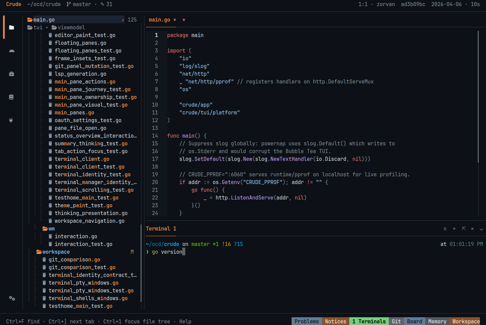
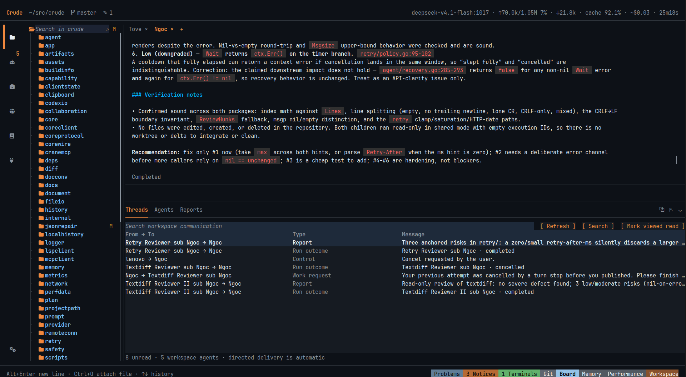

# Crude — the hackable Agentic Development Environment

**An ADE for humans and agents. Both first-class. Neither in the other's way.**

Our ambition: the first environment built around agentic development, not an
agent bolted onto an editor. Humans and agents deserve equal respect.

Crude is an opinionated, open-source **Agentic Development Environment (ADE)**
written in Go. It brings AI coding agents, your editor, terminals and review tools
into one terminal-native workspace on Linux and Windows. Use your **mouse or
keyboard**: click, drag, browse menus, or take a shortcut when it helps. It's 2026;
you shouldn't need to memorize a thousand keybindings to get work done.

[Documentation](docs/README.md) · [Releases](https://github.com/agenticcrude/crude/releases) ·
[Report a bug](https://github.com/agenticcrude/crude/issues) · [Apache-2.0](LICENSE-APACHE)



> **Active development / beta testing.** Crude and its agents can change files and
> execute commands. Bugs, incompatible changes, or agent mistakes can damage or
> lose work. Commit your changes, keep independent backups, review actions, and
> do not rely on Crude as your only copy. Installers require explicit acceptance.

## Less configuring. More developing.

Crude gets out of your way — and your agents' way. Useful defaults, discoverable
controls, one coherent workspace. No endless editor-plugin configuration.

- **Agents with a workspace:** multi-agent delegation, plans, reports, shared
  project memory, and recoverable interrupted work.
- **An IDE you can stay in:** editor, LSP integration, file search, split panes,
  floating windows, and native Linux PTY / Windows ConPTY terminals.
- **Review before trust:** Git diffs, staging and history, permission controls,
  managed worktrees, and Local History previews/undo. Not a security sandbox.
- **Your models and tools:** configurable provider accounts, local models,
  Skills and MCP integrations. Bring your own account; provider charges may apply.
- **A retained core:** shells attach to long-lived workspace actors. Closing a
  shell detaches it; it does not deliberately terminate running agent work.

**Deliberately no editor plugin system.** Want a different workflow? Fork or
clone Crude, run it from source, and ask Crude itself to implement the change.
Skills and MCP connect your agents to tools; they aren't an editor-plugin treadmill.

<details>
<summary>See the agent workspace</summary>



Real product captures of this repository. The example conversation is served by
a local screenshot fixture, not a claim of a live model's output.
</details>

## Install or update

**Release preparation:** the commands below become available after the first
public release is published. Until then, [build from source](#build-from-source).

**Linux x86-64** — glibc 2.35+ (Ubuntu 22.04+ or equivalent), Bash, curl, GNU tar:

```bash
installer=$(mktemp) &&
  curl -fsSL https://github.com/agenticcrude/crude/releases/latest/download/install.sh -o "$installer" &&
  bash "$installer" --accept-beta-risk
```

**Windows x64** — Windows 10 1809+ / Windows 11, PowerShell 5.1+:

```powershell
$installer = Join-Path $env:TEMP ('crude-install-' + [guid]::NewGuid() + '.ps1')
Invoke-WebRequest https://github.com/agenticcrude/crude/releases/latest/download/install.ps1 -OutFile $installer -ErrorAction Stop
& $installer -AcceptBetaRisk
```

Read the script before running it if you prefer. No Go, Zig or administrator
rights are needed for the binary install. The same command updates Crude, verifies
the release archive's SHA-256, and preserves application data. Latest selects a
non-prerelease release; use `--version vX.Y.Z-beta.1` / `-Version vX.Y.Z-beta.1`
for a specific beta. macOS, ARM64 and Alpine/musl release packages are not offered.

Open a fresh terminal, run `crude` in your project, and add a provider account in
**Tools → Settings → Accounts**. Select its model under **Agents**. Use
the menus and bottom panels to explore — **Ctrl+Alt+P** opens commands and
**Alt+F12** opens the terminal if you prefer shortcuts.

### Opinionated by design

For the intended look: current **Kitty or Alacritty** on Linux, **Windows Terminal**
on Windows, truecolor, and **JetBrainsMono Nerd Font NF** — not NFM. Install the
[font](https://www.nerdfonts.com/font-downloads), select it in your terminal, then
enable **Nerd font** and **Show file icons** under **Settings → IDE → Interface**.
The installers warn about missing or unverifiable setup, but never change fonts
or terminal settings for you. Ask Crude: **“Help me set up the ideal Crude terminal;
explain each change and ask before making it.”**

## Build from source

Use the Go version in `go.mod`, Zig 0.16.0 and Git. Linux also needs a C compiler,
libc headers and `tic` (ncurses). The terminal library is pinned and linked with cgo.

```bash
make libghostty
. scripts/libghostty_env.sh
go run .
```

Windows: run `scripts/bootstrap_libghostty.ps1`, dot-source
`scripts/libghostty_env.ps1`, then `go run .` in PowerShell. `make build` produces
a standalone Linux binary. When hacking on Crude inside Crude, use a separate
`CRUDE_HOME` profile so your development core doesn't disturb your working one.

## Humans and agents welcome

The source is documented for **agents to hack on as readily as humans**.
Start with [AGENTS.md](AGENTS.md) for repository rules, the
[documentation index](docs/README.md) for architecture and contracts, and
[validation](docs/guides/validation.md) for test/lint/design/performance gates.
[Release requirements](docs/guides/releases.md) describe the native build matrix,
installer options and publication checklist. A green build is not a safety guarantee.

**License:** Crude's original code is **Apache-2.0**. Third-party code retains its
own licenses; see [NOTICE](NOTICE), [Codex attribution](codexio/NOTICE) and the
notices bundled with releases. `LICENSE-MIT` is retained for upstream material,
not an alternative license for Crude.
