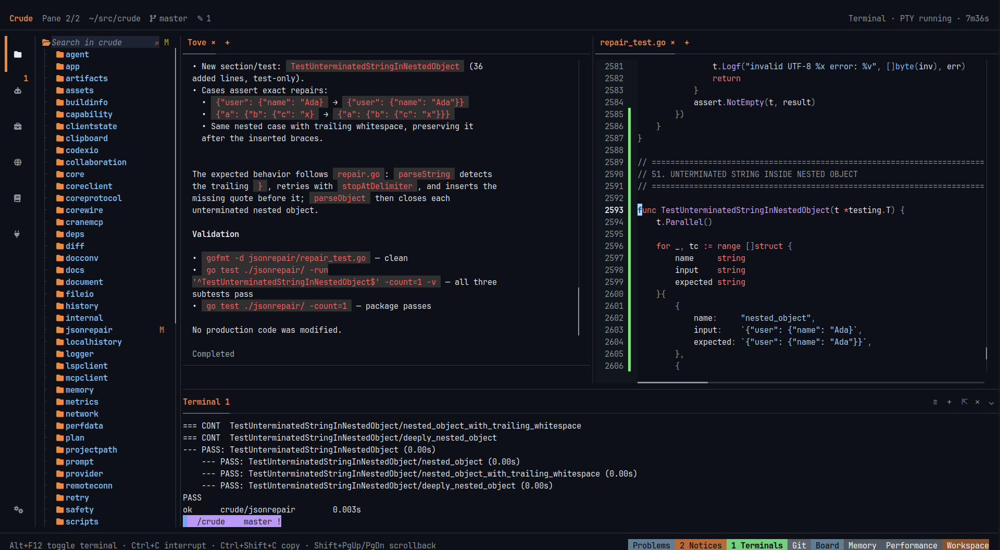
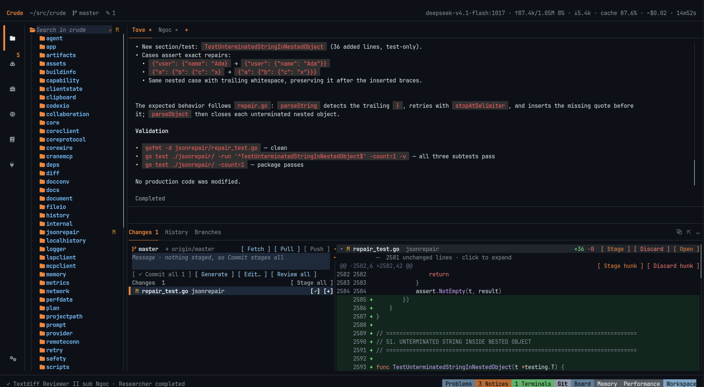
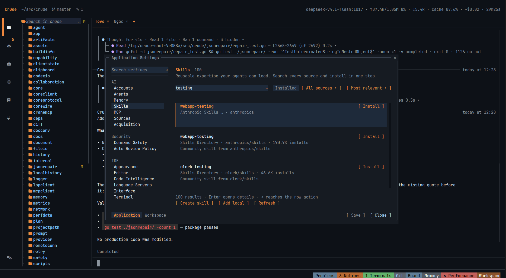

<p align="center">
  
</p>

<h1 align="center">Crude</h1>

<p align="center">
  <strong>Build with agents. Review everything.</strong><br>
  A terminal-native development environment for Linux and Windows.
</p>

<p align="center">
  <a href="https://opencrude.github.io/">Website</a> ·
  <a href="#install">Install</a> ·
  <a href="docs/README.md">Documentation</a> ·
  <a href="https://github.com/opencrude/crude/releases">Releases</a> ·
  <a href="https://github.com/opencrude/crude/issues">Report a bug</a>
</p>



<sub>Real capture. A live agent added a regression test. The editor shows the change. The terminal shows that the tests pass.</sub>

> [!WARNING]
> Crude is beta software. Crude and its agents can change files and run commands.
> A bug or an agent mistake can damage or delete your work. Commit your changes,
> keep backups and review agent actions. The installers ask for your consent.

## What Crude does

Crude puts your editor, terminals, Git review and AI agents in one workspace.
A core process owns this workspace. When you close the window, the work continues.

| Area | What you can do |
|---|---|
| **Agents** | Give a task to an agent. Let it delegate parts to child agents and read their reports. Use plan mode, goals and session fork. |
| **Workspace** | Edit code with language servers. Split panes. Use embedded terminals: PTY on Linux, ConPTY on Windows. |
| **Review** | Stage or discard each file or hunk. Approve risky commands before they run. Restore files from Local History. |
| **Models and tools** | Use 20 provider templates, any OpenAI-compatible API or a local model. Add Agent Skills and MCP servers. |
| **Core** | Keep sessions, agents and terminals alive after you close the window. Attach again later, or attach over SSH. |

Crude is not a security sandbox. Agent commands run with your user permissions.

## Install

**Linux x86-64** (glibc 2.35 or later):

```bash
curl -fsSL https://github.com/opencrude/crude/releases/latest/download/install.sh -o install.sh
bash install.sh --accept-beta-risk
```

**Windows x64** (PowerShell 5.1 or later):

```powershell
Invoke-WebRequest https://github.com/opencrude/crude/releases/latest/download/install.ps1 -OutFile install.ps1
.\install.ps1 -AcceptBetaRisk
```

Read the installer before you run it. To update Crude, run the same command again.
You do not need administrator rights.

## Get started

1. Open a terminal in your project folder.
2. Run `crude`.
3. Go to **Tools → Settings → Accounts** and add a provider account.
4. Go to **Agents** and select a model.
5. Type a task in the composer and press **Enter**.

Press **Ctrl+Alt+P** to see all commands and their shortcuts. Press **Alt+F12** to open the terminal.

**Recommended setup:** Use Kitty or Alacritty on Linux, or Windows Terminal on Windows,
with truecolor. Install [JetBrainsMono Nerd Font](https://www.nerdfonts.com/font-downloads)
(NF, not NFM). Then enable **Nerd font** and **Show file icons** in
**Settings → IDE → Interface**. The installers do not change your terminal or fonts.

<details>
<summary><strong>More captures</strong></summary>






All captures show Crude on its own source code with a live model.
</details>

## Build from source

You need the Go version in `go.mod`, Zig 0.16.0 and Git. On Linux, you also need
a C compiler, libc headers and `tic` (ncurses).

```bash
make libghostty
. scripts/libghostty_env.sh
go run .
```

On Windows, run `scripts/bootstrap_libghostty.ps1`. Then dot-source
`scripts/libghostty_env.ps1` and run `go run .` in PowerShell.
To make a standalone Linux binary, run `make build`.

When you develop Crude inside Crude, set a different `CRUDE_HOME`.
This keeps your development core separate from your working core.

## Change Crude

Crude has no editor plugin system. To change a workflow, clone the source,
open it in Crude and ask an agent to make the change. The repository is
documented for agents and for people:

- [AGENTS.md](AGENTS.md): the rules for every change.
- [Documentation index](docs/README.md): the architecture and the contracts.
- [Validation](docs/guides/validation.md): the test, lint, design and performance gates.

## License

The original code of Crude is licensed under [Apache-2.0](LICENSE-APACHE).
Third-party code keeps its own license. See [NOTICE](NOTICE),
[Codex attribution](codexio/NOTICE) and the notices in each release.
`LICENSE-MIT` applies to upstream material only. It is not an alternative license for Crude.
